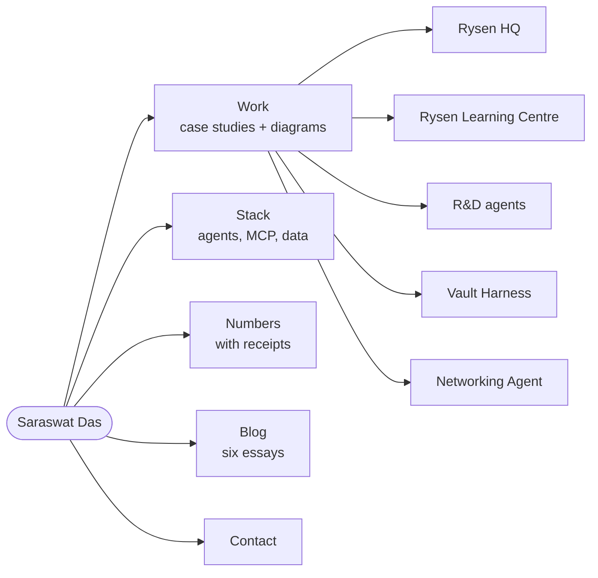

# Saraswat Das

Tech lead building multi-agent infrastructure and the products around it. Remote, open to roles.

| Go to | Link |
|---|---|
| Portfolio home | https://saraswat123.github.io/ |
| Work and case studies | https://saraswat123.github.io/work/ |
| Stack | https://saraswat123.github.io/stack/ |
| Numbers with receipts | https://saraswat123.github.io/numbers/ |
| Blog | https://saraswat123.github.io/blog/ |
| Contact | https://saraswat123.github.io/contact/ |
| LinkedIn | https://www.linkedin.com/in/saraswat-das/ |

**Public code:** [Networking-Agent.md-](https://github.com/Saraswat123/Networking-Agent.md-) (Rust MCP server, 56 tools) · [Rysen-Learning-System](https://github.com/Saraswat123/Rysen-Learning-System) · [rysen-lpc-ocr](https://github.com/Saraswat123/rysen-lpc-ocr) · merged PRs in [moltis](https://github.com/moltis-org/moltis/pulls?q=is%3Apr+author%3ASaraswat123+is%3Amerged)
